# SXKJ-Open-After-School-Server
# 一、系统介绍
<font style="color:rgb(31, 35, 40);">长沙思旋Ziran-知冉云课后服务管理平台面向中小学教育教学、学生管理、家校沟通、家校协同、AI阅卷、学生选课调课、课后研学等场景于一体的综合性服务平台，平台实现公开选课、邀请选课和行政班选课一体化管理，覆盖课后服务全流程闭环管理，实现场景包含教师排课、学生选课调课、班主任调课、学生请假、教师点到、学生去向追踪、学生安全一键预警、课后统计（教师和学生维度），平台班主任移动端工作台核心功能包含我的待办、学生调课、考勤管理、课表管理、评价管理、自然班级管理、学生请假以及课后统计（课时统计、数据看板、课程评价分析）。</font>

**版本说明：**

| **版本** | **班主任端** | **学生家长端** | **管理后台** |
| --- | --- | --- | --- |
| 开源版 | 首页、选课报名、课后去向、我的(班级学生查询)、个人信息、系统设置、登录、注册。 | 首页、选课报名、课程表、我的(小孩查询/选课记录)、个人信息、系统设置、登录、注册。 | 首页工作台、学生管理(学生学信息/课后信息/课表/请假)、教师管理、排课管理、学生选课、课程班管理、教务管理、系统管理(用户管理/角色管理/菜单管理/日志管理)、个人中心、登录。 |
| 标准版 | 首页、我的代办、考勤统计、选课报名、课后去向、去向预警提醒、班级管理(学生请假/学生调课/课后去向/选课报名)、评价任务、巡课任务、巡课整改、知识库、通知发布、多角色身份切换(实现同时是家长和教师身份的切换)、我的(班级学生查询)、个人信息、系统设置、登录、注册、消息中心。 | 首页、选课报名、课程表、请假管理、考勤管理、评价任务、身份管理(多小孩切换/添加)、我的(小孩查询/选课记录)、数据看板/学情报告、个人信息、系统设置、登录、注册、意见反馈、消息中心。 | 首页工作台、学生管理(学生学信息/课后信息/课表/请假)、教师管理、排课管理、学生选课、课程班管理、教师调课、考勤管理、学生调课、课堂表现、学习成果、后勤安全、巡课管理(巡课计划/巡课记录/问题整改工单)、学生安全(学生去向轨迹)、评价管理(评价指标体系/评价任务/评价题库/评价模板/评价查询)、统计分析(数据看板/课时统计/学生统计/课程评价统计)、教务管理、系统管理(用户管理/角色管理/菜单管理/日志管理/消息中心/短信管理)、个人中心、登录。 |
| 旗舰版 | 包含标准版所有能力，另外新增AI阅卷(作业批阅/错题本/学生报告/会员中心/我的订单) | 包含标准版所有能力，另外新增AI阅卷(智能批阅/错题本/会员中心/我的订单) | 包含标准版所有能力，另外新增AI管理(AI配置/AI批改明细/错题本/学生学情报告/班级学情报告)、知识点管理、题库管理、会员权益管理。 |


系统截图：

管理端

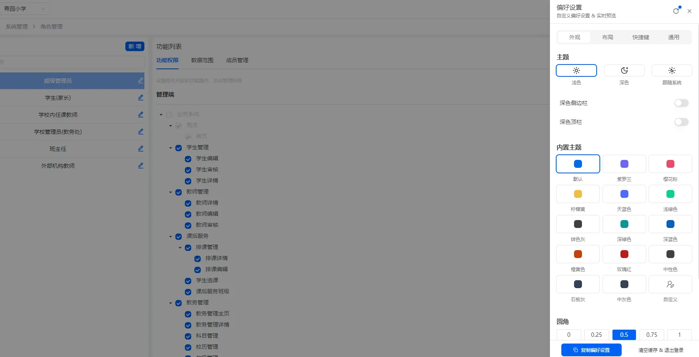

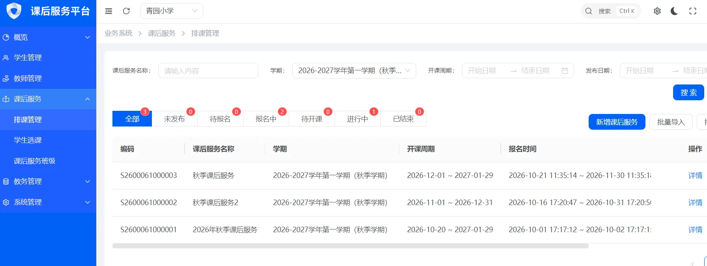

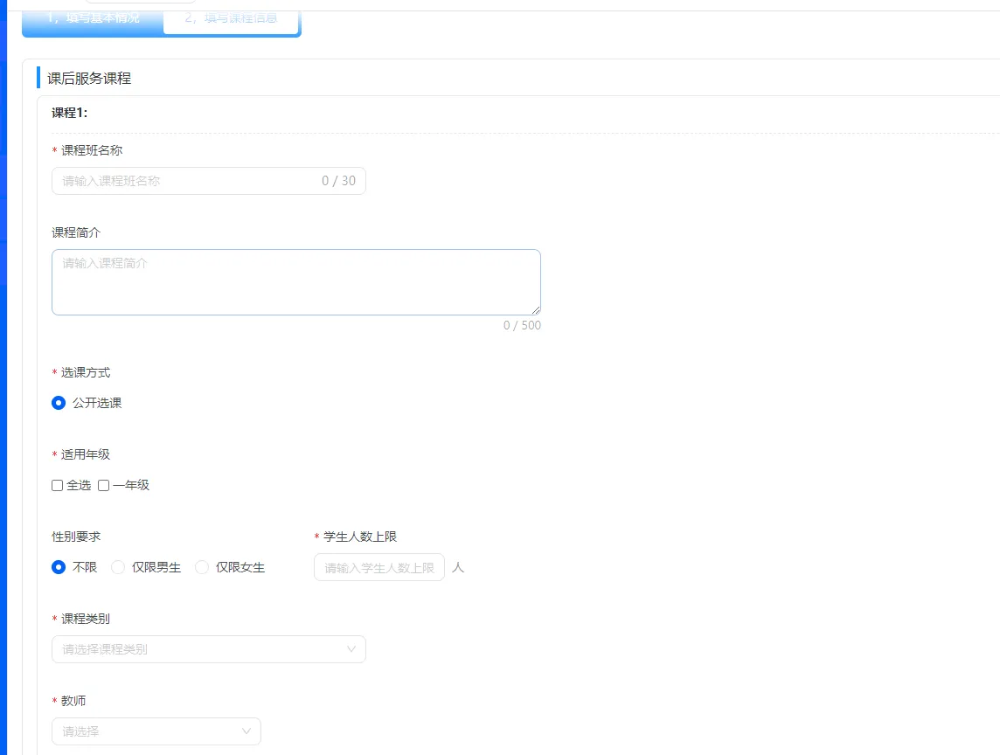


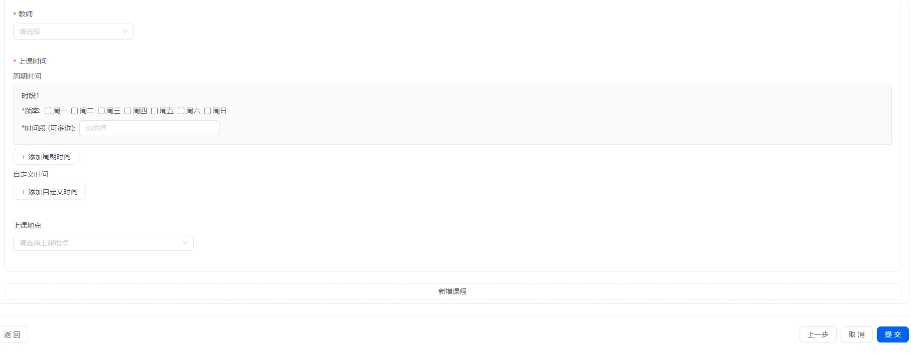

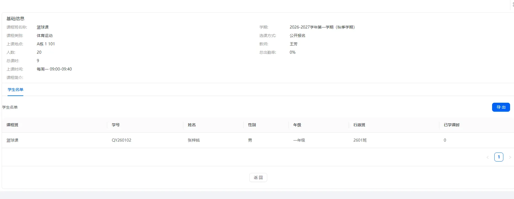


移动端

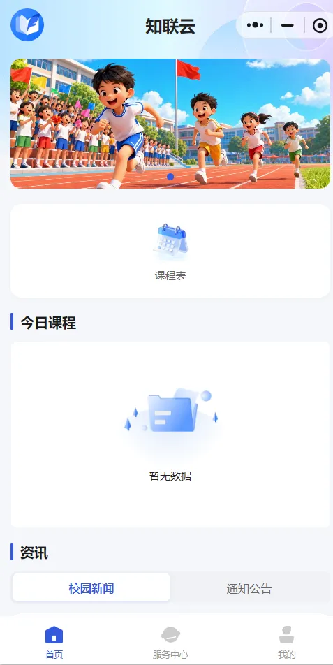

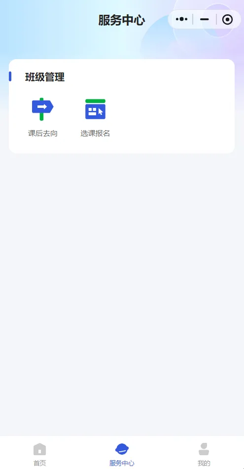

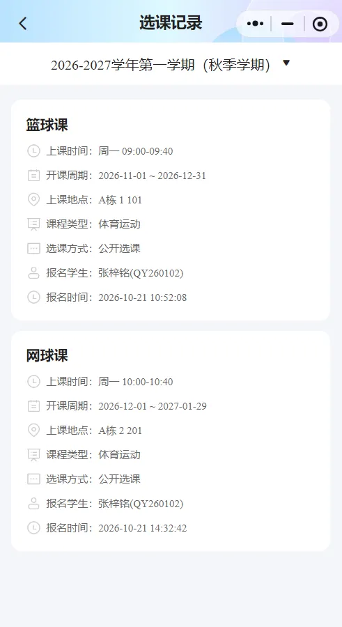

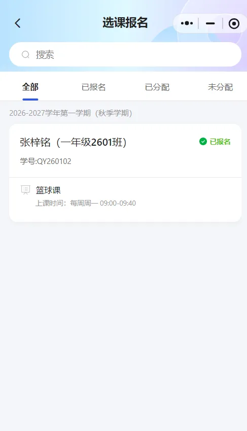

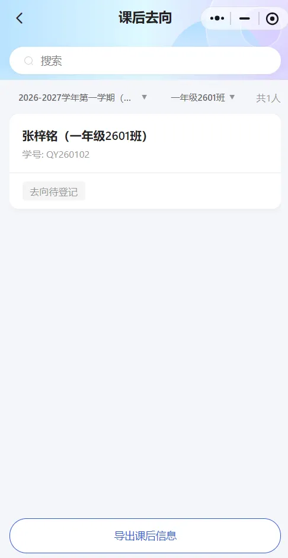

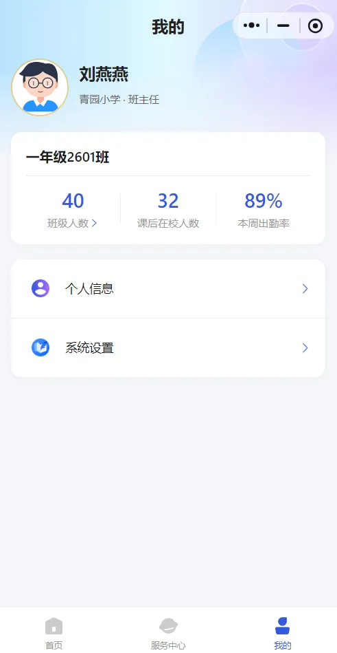

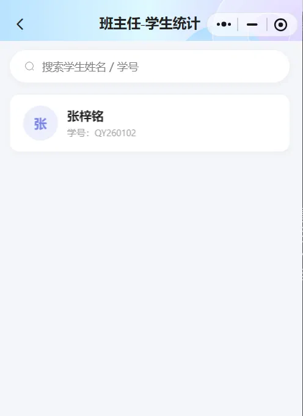

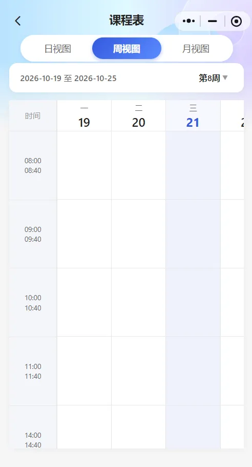

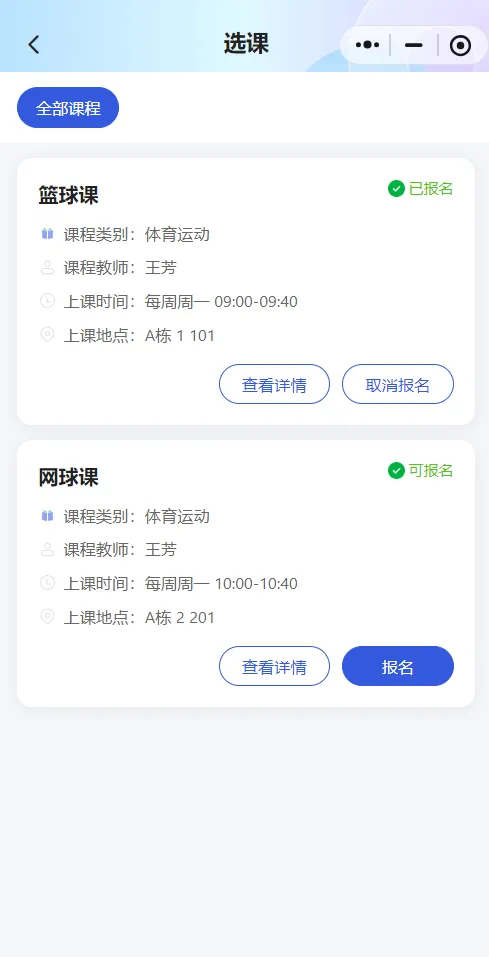

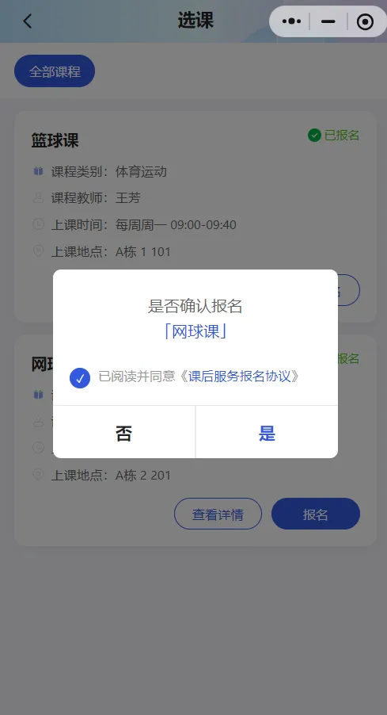

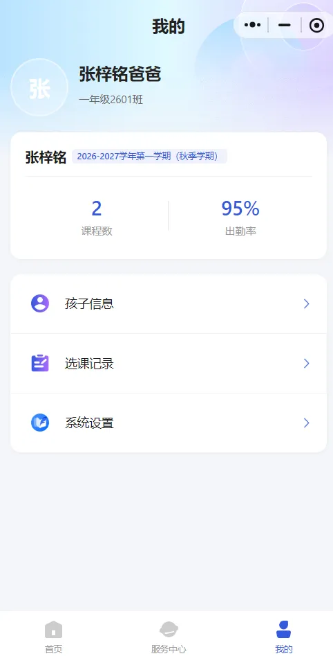

身份切换

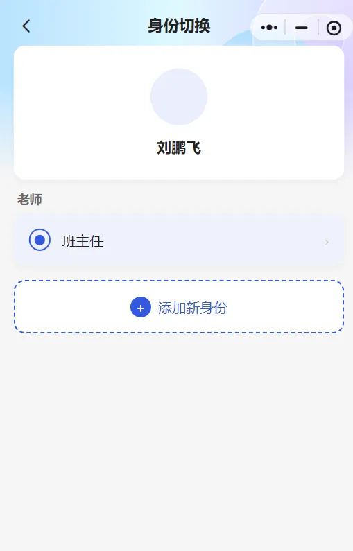


# 二、软件架构
## 1. 系统架构与技术栈
### 1.1 总体架构
```plain
┌─────────────────────────────────────────────┐
│           前端（Web / H5 / 小程序）            │
└───────────────────┬─────────────────────────┘
                    │ HTTPS
┌───────────────────▼─────────────────────────┐
│           Nginx（反向代理 / 静态资源）          │
└───────────────────┬─────────────────────────┘
                    │
┌───────────────────▼─────────────────────────┐
│        auth-server-api（核心业务服务）         │
│  Controller → Service → Mapper(DAO) → MySQL  │
│  · JWT 鉴权 / 接口限流 / 数据权限(DataScope)    │
│  · @OperateLog 操作日志切面                    │
└────┬──────────┬──────────┬──────────────────┘
     │          │          │
┌────▼───┐ ┌────▼────┐ ┌───▼─────────┐
│ MySQL  │ │  Redis  │ │ FastDFS 文件 │
│ 5.7    │ │ (Redis) │ │   存储服务   │
└────────┘ └─────────┘ └─────────────┘
```

**架构模式**：单体分层架构（Controller - Service - DAO 三层），Maven 多模块聚合工程，  
通过自定义注解（`@OperateLog`、`@AccessLimit`、`@DataScope`、`@NoNeedLogin`）实现横切关注点。

### 1.2 技术栈清单
| 分类 | 技术 | 版本 | 说明 |
| --- | --- | --- | --- |
| 开发语言 | Java | 1.8 | JDK 1.8 及以上 |
| 核心框架 | Spring Boot | 2.2.5.RELEASE | Web、Validation、Task 等 |
| 持久层 | MyBatis-Plus | 3.4.1 | 含分页插件 PageVo |
| 数据库 | MySQL | 5.7 | mysql-connector-java 8.0.22 |
| 连接池 | Druid | 1.1.21 | 含 SQL 监控（/druid） |
| 缓存 | Redis + Redisson | 3.15.5 | 分布式锁、缓存封装 |
| 文件存储 | FastDFS | 1.27.2 | tracker/client |
| 接口文档 | Swagger2 + Knife4j | 2.7.0 / 2.0.9 | dev/online 环境启用 |
| 认证 | JWT | 0.9.1 | Token 鉴权 |
| JSON | FastJSON / Jackson | 1.2.70 | 日期、Long 序列化定制 |
| 工具库 | Hutool / Commons-Lang3 / Guava | 5.4.1 / 3.10 / 23.0 | — |
| Excel | EasyExcel | 2.2.6 | 导入导出 |
| 模板引擎 | Velocity | 1.7 / 2.0 | 代码生成器 |
| HTTP 客户端 | OkHttp | 3.14.7 | 第三方系统对接 |
| 验证码 | Kaptcha | 2.3.2 | 图形验证码 |
| 简化开发 | Lombok | 1.18.x | — |
| 构建 | Maven | 3.6+ | 多模块聚合构建 |
| 监控 | Spring Actuator + Prometheus | — | 指标暴露与采集 |


---

## 2. 工程模块说明
| 模块 | 说明 |
| --- | --- |
| `sxkj-edu-common` | 公共工具服务：自定义注解、常量/枚举、全局异常、分页、Redis 封装、校验器、Excel/PDF/日期等工具类 |
| `sxkj-edu-generator` | MySQL 逆向代码生成器（Velocity 模板） |
| `auth-server-api` | 核心业务服务：基础服务 + 业务服务接口、系统对接实现、定时任务、拦截器 |


`auth-server-api` 内部分层：

```plain
com.sxkj.edu
 ├─ controller    # 业务 API 入口，按一级菜单分包，必须添加 @OperateLog
 ├─ service       # 接口定义(IService) + 实现(ServiceImpl)
 ├─ domain        # 领域模型：PO(数据表) / DTO(传输) / VO(返回) / AO(入参)
 ├─ module        # 基础服务-系统管理
 ├─ handle        # 全局统一处理
 ├─ interceptor   # 全局拦截器
 ├─ job           # 定时任务
 └─ config        # 集成、消息、监控、swagger 等配置
```

## 3. 环境要求
| 软件 | 版本要求 |
| --- | --- |
| JDK | 1.8（推荐 1.8.0_131+） |
| Maven | 3.6+ |
| MySQL | 5.7+（字符集 utf8mb4） |
| Redis | 5.0+ |
| FastDFS | 6.x（tracker + storage） |
| Nginx | 1.18+（反向代理，可选） |


#### 安装教程
1. 获取代码  
   git clone [https://github.com/sxkj-jiang/SXKJ-Open-After-School-Server.git](https://github.com/sxkj-jiang/SXKJ-Open-After-School-Server.git)  
   cd sxkj-open-after-school-server
2. 初始化数据库  
   2.1 创建数据库（utf8mb4 编码）：  
   CREATE DATABASE open_after DEFAULT CHARACTER SET utf8mb4 COLLATE utf8mb4_general_ci;

       2.2 执行建表脚本与初始化数据（见 configs/open_after.sql），直接复制全文内容到 Navicat执行；  
       2.3 (可选)部署 FastDFS（tracker/storage），确认 `tracker-list` 地址可用。

3. 修改配置springboot 环境配置  
   项目采用 `spring.profiles.active` 切换环境，配置文件位于  
   `auth-server-api/src/main/resources/`：

| 文件 | 用途 |
| --- | --- |
| `application.yml` | 主配置（profile、日志、线程池、及格线分数） |
| `application-dev.yml` | 开发环境（端口 7081，context-path `/open/after/v1`） |
| `application-online.yml` | 测试环境 |


**必须修改的关键配置**（请勿使用仓库内任何示例密码）：  
spring:  
datasource:  
url: jdbc:mysql://:3306/open_after?serverTimezone=Asia/Shanghai&useUnicode=true&characterEncoding=utf-8&useSSL=false         username:          password:        redis:         host:          port: 6379         password:

```plain
fdfs:
  tracker-list: <your-fastdfs-tracker>:22122
```

同时修改 `configs/application.properties` 中的 `aes.data.key`、`edu.user.encryptPassword`  
等密钥项（生产环境务必更换）。

4. 启动服务  
   idea里执行：AfterSchoolApplication.java
5. 访问接口文档  
   [http://localhost:7081/open/after/v1/doc.html#/home](http://localhost:7081/open/after/v1/doc.html#/home)


#### 使用说明
1. 环境、账号地址

<font style="color:rgb(64, 72, 91);">产品地址：</font>[<font style="color:rgb(9, 94, 171);">https://www.sixuankj.com</font>](https://gitee.com/link?target=http%3A%2F%2Fwww.5kcrm.com%2F)

<font style="color:rgb(64, 72, 91);">管理后台演示地址：(</font>[<font style="color:rgb(9, 94, 171);">https://open.sixuankj.com/</font>](https://gitee.com/link?target=https%3A%2F%2Fdemo10.72crm.com%2F%23%2Fcrm)<font style="color:rgb(64, 72, 91);">open-after)  
</font><font style="color:rgb(64, 72, 91);">帐号：admin密码：sx666666</font>

<font style="color:rgb(64, 72, 91);">#移动端体验账号密码：</font>

<font style="color:rgb(64, 72, 91);">家长账号:18717101501</font>

<font style="color:rgb(64, 72, 91);">任课老师账号:18718101501</font>

<font style="color:rgb(64, 72, 91);">班主任账号:18718101502 </font>

<font style="color:rgb(64, 72, 91);">密码都为: sx666666</font>

<font style="color:rgb(64, 72, 91);">小程序H5体验地址：</font>

<font style="color:rgb(64, 72, 91);"></font>

2. 联系我们(商务合作)

<font style="color:rgb(64, 72, 91);">扫码添加小冉官方客服微信，邀您加入千人微信交流群：</font>


<font style="color:rgb(64, 72, 91);">扫码关注知冉云公众号，了解平台更多一手资讯。</font>


<font style="color:rgb(64, 72, 91);"> </font>

3. 项目前端地址

管理端：

[https://gitee.com/link_2020/open-after-school-web.git](https://gitee.com/link_2020/open-after-school-web.git)

H5端：

[https://gitee.com/link_2020/open-after-school-h5.git](https://gitee.com/link_2020/open-after-school-web.git)

#### 
#### 参与贡献
<font style="color:rgb(64, 72, 91);">感谢您关注本项目！在提交 Issue 或 Pull Request 之前，请先阅读以下约定。</font>

## <font style="color:rgb(64, 72, 91);">1. 行为准则</font>
<font style="color:rgb(64, 72, 91);">参与本项目即表示您同意遵守</font>[<font style="color:rgb(64, 72, 91);">行为准则</font>](CODE_OF_CONDUCT.md)<font style="color:rgb(64, 72, 91);">，保持尊重与专业。</font>

## <font style="color:rgb(64, 72, 91);">2. 环境准备</font>
+ <font style="color:rgb(64, 72, 91);">JDK 1.8（推荐 1.8.0_131+）</font>
+ <font style="color:rgb(64, 72, 91);">Maven 3.6+</font>
+ <font style="color:rgb(64, 72, 91);">MySQL 5.7+ / Redis 5.0+ / FastDFS 6.x</font>
+ <font style="color:rgb(64, 72, 91);">复制根目录 </font>`<font style="color:rgb(64, 72, 91);">.env.example</font>`<font style="color:rgb(64, 72, 91);"> 为 </font>`<font style="color:rgb(64, 72, 91);">.env</font>`<font style="color:rgb(64, 72, 91);">，填入本地环境真实值（</font>`<font style="color:rgb(64, 72, 91);">.env</font>`<font style="color:rgb(64, 72, 91);"> 不会提交）</font>

## <font style="color:rgb(64, 72, 91);">3. 分支模型</font>
| <font style="color:rgb(64, 72, 91);">分支</font> | <font style="color:rgb(64, 72, 91);">用途</font> | <font style="color:rgb(64, 72, 91);">保护</font> |
| --- | --- | --- |
| `<font style="color:rgb(64, 72, 91);">master</font>` | <font style="color:rgb(64, 72, 91);">主线，仅接受发版合并</font> | <font style="color:rgb(64, 72, 91);">禁止直接推送</font> |
| `<font style="color:rgb(64, 72, 91);">release1.0</font>` | <font style="color:rgb(64, 72, 91);">开发测试环境版本</font> | <font style="color:rgb(64, 72, 91);">禁止直接推送</font> |
| `<font style="color:rgb(64, 72, 91);">develop</font>` | <font style="color:rgb(64, 72, 91);">测试环境稳定版</font> | <font style="color:rgb(64, 72, 91);">禁止直接推送</font> |


<font style="color:rgb(64, 72, 91);">功能开发请从 </font>`<font style="color:rgb(64, 72, 91);">release1.0</font>`<font style="color:rgb(64, 72, 91);"> 切出特性分支：</font>

```bash
git checkout release1.0
git pull
git checkout -b feature/your-feature
```

## <font style="color:rgb(64, 72, 91);">4. 代码提交规范及注意事项</font>


```plain
## 1. 安全红线（PR 必查）

- 禁止提交任何密码、密钥、Token、真实服务器 IP、内网地址；
- 禁止提交 `.env`、日志文件、真实用户数据（含人脸等生物信息）；
- 新增依赖前确认许可证兼容 Apache-2.0；
- 发现安全漏洞请勿公开 Issue。

## 2. 提交 Pull Request

1. Fork 仓库或使用特性分支；
2. 确保 `mvn clean package -DskipTests` 构建通过；
3. PR 描述包含：变更背景、影响范围、自测结果、关联 Issue；
4. 至少一名维护者 Code Review 通过后合并。

## 3. Issue 规范

- Bug 反馈请包含：环境（dev/online）、复现步骤、期望结果、实际结果、相关日志（脱敏后）；
- 功能建议请说明使用场景与预期方案。
```
